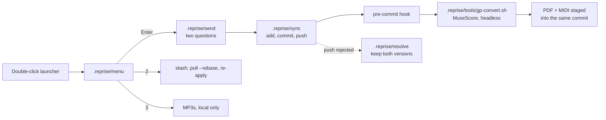

# reprise

**Git-backed tab sharing for bands.** Change a Guitar Pro file, and its sheet
music and MIDI rebuild and travel with it. Your bandmates double-click one
file instead of learning git.

The problem this solves is not conversion. It is that the people who most need
a shared, versioned folder of tabs are usually the least able to operate one.
Everything here is arranged around that: the git concepts are hidden, every
failure says what to do next, and nothing can leave someone stranded in a
state they would need help to escape.

```
================ REPRISE ================

  1  Send my work to the band   (just press Enter)
  2  Get everyone else's latest
  3  Make play-along MP3s
  q  Close
```

## Highlights

- **One file to double-click.** `Reprise (MAC).command` or
  `Reprise (WINDOWS).cmd`. First launch runs setup itself, so nobody has to be
  told about it.
- **Sheet music and MIDI are rebuilt on commit** by a pre-commit hook and ride
  along in the same commit. A song missing its assets gets them filled in on
  the next commit anyone makes, so the repo converges on complete.
- **Binary conflicts are survivable.** Two people editing the same tab is not
  mergeable by any tool. Both versions are kept, the band's becomes live, and
  yours is written beside it with your name on it to merge in Guitar Pro.
- **Play-along MP3s on demand**, with no click track and no count-in. Local
  only, never committed.
- **54 tests**, none of which need MuseScore installed.

## How it works



There is no Guitar Pro CLI. Arobas ships none, and the Batch Converter inside
the app only upgrades older GP formats to `.gp`, so MuseScore Studio is the
only headless path from a tab to a PDF.

Key design choices:

- **Only staged scores rebuild.** PDF and MP3 encoders stamp timestamps into
  their output, so rebuilding everything on every commit would mark every
  asset as changed every time and the history would stop telling you what
  actually changed.
- **Assets are moved aside before conversion and restored on failure.**
  Otherwise a failed conversion leaves yesterday's PDF in place, the freshness
  check reads it as success, and sheet music that no longer matches the tab
  gets committed silently.
- **A missing MuseScore warns but never blocks a commit.** Stopping someone
  saving a tab edit because their laptop lacks a converter is worse than
  letting assets lag. A *failed* conversion does block, because that is a real
  problem with the thing you just changed.
- **Scripts call each other with `bash path/to/script`.** A lost executable
  bit then cannot break the chain. Only the launcher and the hook genuinely
  need the bit, because the OS and git invoke those directly.

## Repository layout

```
Reprise (MAC).command      double-click launcher, macOS
Reprise (WINDOWS).cmd      double-click launcher, Windows
.reprise/menu              what the launcher opens; self-installs on first run
.reprise/send              asks two questions, builds the commit message
.reprise/sync              add, commit, push, with catch-up on rejection
.reprise/resolve           same-song conflicts: keep both versions
.reprise/mp3               play-along audio, on demand, never committed
.reprise/setup             per-machine install; also parses every script
.reprise/reprise.conf      shared settings, committed
.reprise/hooks/pre-commit  rebuild and stage assets
.reprise/tools/            the MuseScore converter
tests/run.sh               the suite
docs/                      dev log, and the page to hand your bandmates
```

## Quickstart

For the person setting it up. Your bandmates read
[docs/for-the-band](docs/for-the-band/README.md) instead, which never mentions
git.

```bash
# 1. Install MuseScore Studio (free) from https://musescore.org
#    Version 4 or newer. You never open it; it runs headless.

# 2. Copy the tooling into the repo that holds your tabs
cp -R .reprise "Reprise (MAC).command" "Reprise (WINDOWS).cmd" \
      .gitattributes /path/to/your/tabs/

# 3. Tell it who to point people at when something breaks
$EDITOR /path/to/your/tabs/.reprise/reprise.conf   # CONTACT_NAME, CONTACT_HOW

# 4. Install the hook on this machine
cd /path/to/your/tabs && bash .reprise/setup

# 5. From then on, for everyone
./"Reprise (MAC).command"
```

One folder per song, with the `.gp` inside it. Generated assets land beside
it:

```
my-song/my-song.gp     the tab, the only thing you edit
my-song/my-song.pdf    sheet music, committed, arrives on pull
my-song/my-song.mid    MIDI, committed
my-song/my-song.mp3    audio, gitignored, built with option 3
```

## Settings

`.reprise/reprise.conf` is committed, so a change applies to everyone.

| Setting | Default | Notes |
|---|---|---|
| `COMMIT_FORMATS` | `pdf,mid` | Built and committed on every tab commit. |
| `COMMIT_MP3` | `0` | Set to `1` only if someone genuinely cannot run MuseScore. Audio re-encodes to different bytes every render, so git stores a fresh multi-megabyte blob per song per edit. Pair it with Git LFS. |
| `MP3_BITRATE` | `256` | |
| `CONTACT_NAME` | `whoever set this up` | Appears in error messages and on the stop screen. |
| `CONTACT_HOW` | empty | Optional second line on the stop screen. |

## Tests

```bash
bash tests/run.sh
```

54 checks covering both workflows, selective rebuilds, self-healing gaps, a
corrupt score blocking a commit while preserving the prior PDF and the edit,
the missing-MuseScore path, the stash-pull-reapply cycle, and same-song
conflicts from both directions.

Fixtures are built with `git checkout-index`, so files arrive with the modes a
clone would give them. This is deliberate: an earlier harness copied files and
ran `chmod +x` on the copies, which made a missing executable bit impossible
to detect, and one shipped.

## Limitations

- **Windows is reasoned, not run.** The launcher locates Git for Windows' bash
  and the paths go through `cygpath`, and both are tested against a simulated
  environment. Neither has executed on Windows. This is the first thing to
  verify if you are adopting it.
- **MuseScore's conversion quality is unverified here.** The suite uses a stub,
  so it proves the workflow, not the output. Whether tempo markings land on the
  staff for your tabs is something you have to check by eye once.
- **GP7 and GP8 drum mapping can be rough** on MuseScore import. Guitar-only
  scores avoid the issue entirely; percussion-heavy ones may not.
- **No Linux launcher.** The scripts are portable bash and will run, but
  nothing double-clicks.
- **Tabs are assumed one-per-folder.** A folder holding two `.gp` files is
  outside what the hook expects.

## License

GPL-3.0. See [LICENSE](LICENSE).
